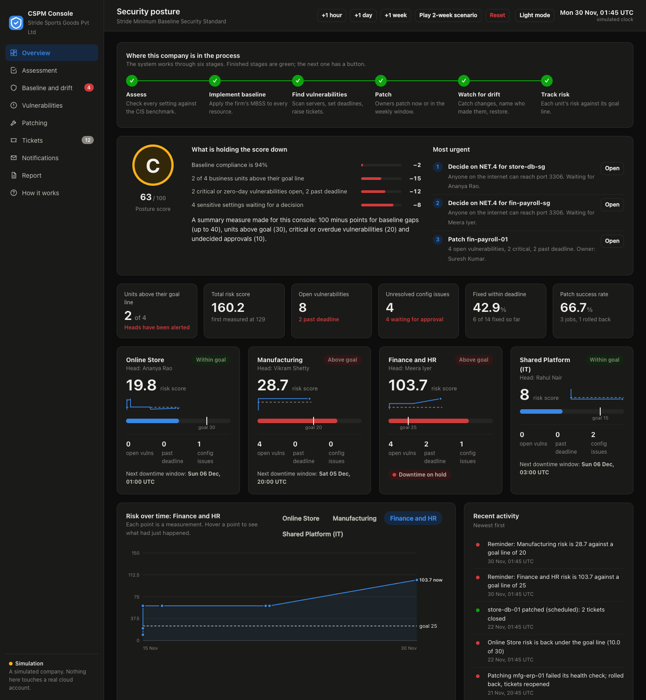
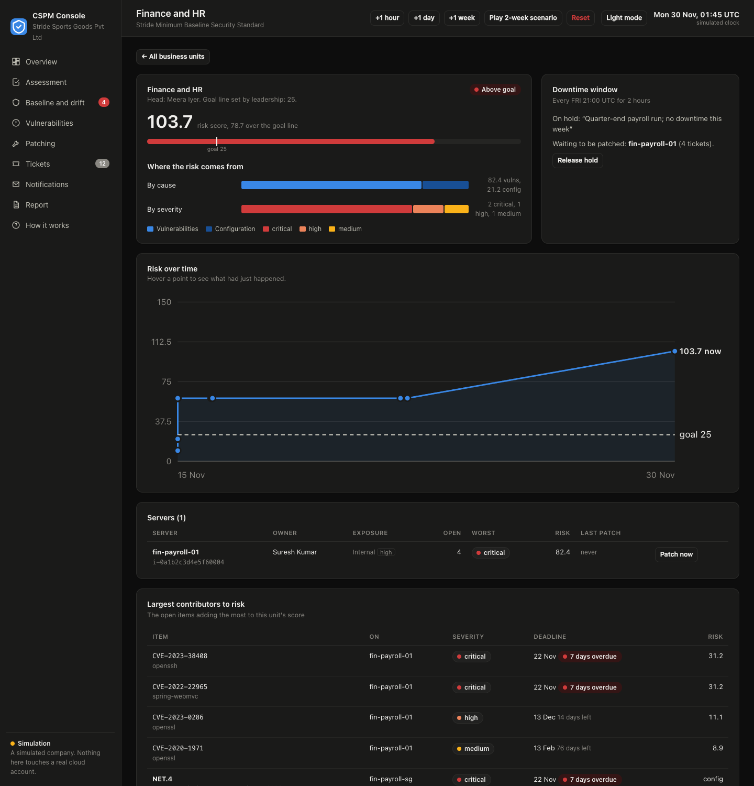
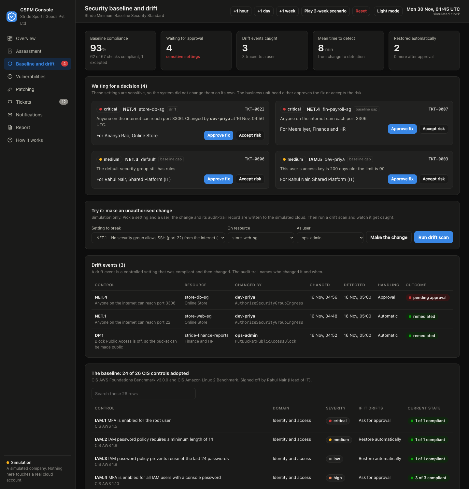
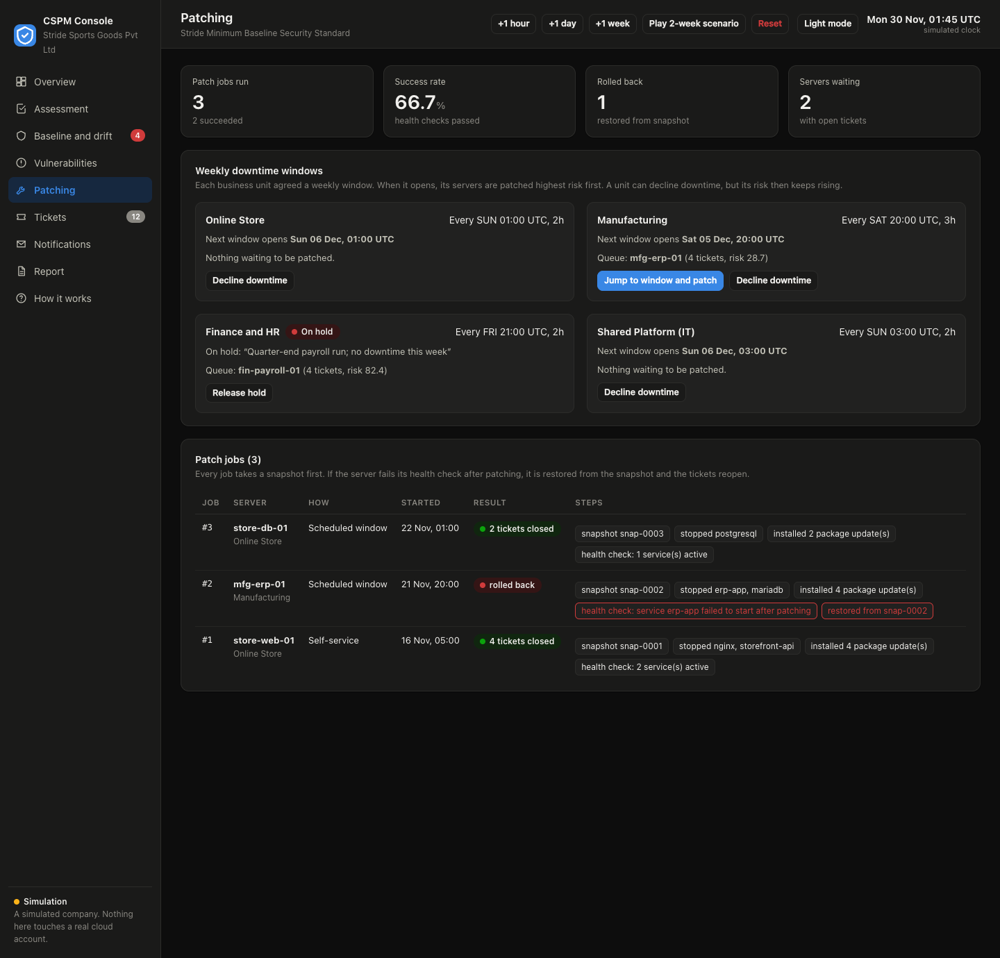

# Cloud Security Posture Management for Mid-Range Firms

A working CSPM prototype. It assesses a cloud environment against CIS controls, enforces a
firm-specific security baseline with drift detection and remediation, automates
vulnerability management from detection to patching with rollback, and scores risk per
business unit against a goal line set by leadership.

Commercial CSPM platforms are priced for large enterprises. This project shows that the core
loop (assess, enforce, detect drift, patch, hold the business accountable for its risk) can be
built on native cloud services and about 3,500 lines of Python.

| Mode | What it talks to | Status |
|---|---|---|
| `mock` (default) | A simulated sports-goods company with planted issues | Runs end to end; 10 automated tests |
| `aws` | A real AWS account built by `terraform/` | Run end to end on a live account in November 2026 |
| `recorded` | The saved data of a past live run | Read-only view, no credentials needed |

## Screenshots

The web console, running the simulated company part-way through its story. One business
unit has declined downtime, so its deadlines have passed and its risk is above the goal line.

**Overview**: progress through the six stages, a posture grade with the most urgent actions,
and each business unit's risk against its goal line.



**Business unit page**: where one unit's risk comes from, its trend against the goal line,
its servers and the items contributing most.



**Baseline and drift**: sensitive settings waiting for a decision, and unauthorised changes
traced to the user who made them.



**Patching**: weekly downtime windows and every patch job step by step, including a
failed job that was rolled back from its snapshot.



## Quick start (no cloud account, nothing to install)

Needs Python 3.9 or later.

```bash
python3 -m cspm web
```

Open http://localhost:8770, press **Reset**, and work through the six stages, or press
**Play 2-week scenario** to watch the whole story. `docs/DEMO_SCRIPT.md` is a 10-minute walkthrough.

```bash
python3 -m cspm demo                          # the same scenario on the command line
python3 -m unittest discover -s tests -v      # tests
```

## What it does

| Stage | Module | What happens |
|---|---|---|
| 1. Assess | `cspm/assessment.py`, `cspm/checks.py` | 26 CIS controls across identity, data protection, network, logging and server security, plus server CVEs. Every gap comes with a plain-language fix. |
| 2. Baseline | `config/mbss.json`, `cspm/drift.py` | The firm adopts a subset of CIS (its MBSS). Safe settings are fixed at once; sensitive ones become approval tickets. |
| 3. Drift | `cspm/drift.py` | A changed setting is detected, traced through the audit trail to the user who changed it, and restored, or ticketed for approve-or-accept. Accepted risks expire. |
| 4. Vulnerabilities | `cspm/vuln.py`, `cspm/nvd.py` | CVEs are scored from the National Vulnerability Database and given deadlines: zero-day immediate, critical 7 days, high 28, medium 90. One ticket per CVE, one email per server. |
| 5. Patching | `cspm/patch.py`, `cspm/scheduler.py` | Self-service or weekly downtime window. Snapshot, stop services, patch, start, health check; restore and reopen tickets on failure. |
| 6. Risk | `cspm/risk.py` | One score per business unit against its goal line. Above the line, the unit head is alerted. |

The web console (`cspm/web.py`, `cspm/webui/`) shows all of it: a posture grade with the most
urgent actions, a page per business unit, approvals, tickets, sent notifications, and a
printable report.

**Design idea:** the engine never calls a cloud API directly. A *provider* returns a neutral
snapshot of the environment and carries out fixes. `providers/mock.py` and `providers/aws.py`
implement the same interface, so the engine is identical in simulation and live, and another
cloud could be added.

## Live run on AWS

Run on a real account (Sydney region, 4 `t3.micro` servers on a December 2022 Amazon Linux 2
image, built by `terraform/`). Measured results, saved in `reports/evaluation_live_aws.md`:

| Stage | Result |
|---|---|
| Assessment | 24 configuration gaps found, including every issue Terraform could plant |
| Baseline | 15 settings fixed automatically, all verified; 5 sent for approval |
| Drift | 3 unauthorised changes made directly in AWS; all 3 detected in 3.6 minutes on average and traced to the right IAM user through CloudTrail. 2 restored automatically, 1 after approval |
| Vulnerabilities | 131 CVE findings across the 4 servers (28 distinct CVEs in the first scan, all scored from NVD) |
| Patching | 6 jobs: 5 succeeded, 1 failed its health check and was **rolled back** from its snapshot, then succeeded on retry. A job took about 6 minutes |
| Outcome | 0 CVEs reported on any server afterwards; every business unit within its goal line |

What the live run changed in the design:

- **The account's free plan blocked Security Hub and Amazon Inspector**, and every region but
  one. The assessment relies on the engine's own CIS checks. For CVEs, the engine asks each
  server's package manager (`yum updateinfo list cves`, through Systems Manager) which CVEs
  its pending updates fix. Inspector is used automatically where it is available.
- **The default AWS patch baseline left 147 lower-severity CVEs behind** on the first patched
  server. `terraform/compute.tf` now defines a baseline that approves all security updates.
- **A rollback left the replaced disk behind**, detached but billable. The provider now asks
  AWS to delete it.
- **The engine must never "fix" its own identity.** Its IAM user has administrator access,
  which the checks would flag and remove. It is excluded.
- **Goal lines tuned in simulation were far too low for real servers**, which carry hundreds of
  CVEs. Live goal lines are set separately (`goal_line_live` in `config/company.json`).

To look at the recorded run: `python3 -m cspm --provider recorded web --port 8771 --state state-aws`.
The `state-aws` folder is not in the repository; it is produced by a live run.

## Running it on your own AWS account

Read `docs/AWS_GO_LIVE.md` first. It costs money or credits, and Terraform creates real
resources. In short:

```bash
pip install -r requirements.txt
cd terraform && terraform init && terraform apply -var alert_email=you@example.com
```

Copy the Terraform outputs into the `aws` block of `config/settings.json`, then:

```bash
export CSPM_PROVIDER=aws CSPM_STATE=state-aws
python3 -m cspm assess
python3 -m cspm baseline apply
python3 -m cspm vuln scan
python3 -m cspm drift scan
python3 -m cspm patch schedule --force
python3 -m cspm risk
```

Destroy it when you finish: `terraform destroy`, then delete any EBS snapshots tagged with
the project name (patch jobs create them outside Terraform).

## Command reference

```bash
python3 -m cspm init                      # reset state
python3 -m cspm assess                    # one-time assessment
python3 -m cspm baseline apply            # implement the MBSS
python3 -m cspm drift scan | list | watch
python3 -m cspm drift decide TKT-0001 restore
python3 -m cspm drift decide TKT-0005 accept --reason "planned for Q2"
python3 -m cspm simulate drift --control NET.1 --resource sg-web-0001 --actor dev-priya
python3 -m cspm vuln scan | list | rescore
python3 -m cspm nvd refresh               # replace cached CVSS scores with live NVD data
python3 -m cspm patch now --server store-web-01
python3 -m cspm patch plan | schedule [--bu ID] [--force]
python3 -m cspm window hold --bu finance-hr --reason "payroll run"
python3 -m cspm risk
python3 -m cspm tickets [--all]; python3 -m cspm ticket TKT-0001
python3 -m cspm dashboard | evaluate
python3 -m cspm clock set 2026-01-10T20:00:00Z | advance --days 3 | clear
```

## Project layout

```
config/      settings, company (business units, goal lines, windows), MBSS
data/        simulated environment, hand-written ground truth, NVD cache
cspm/        engine; providers/ (mock, aws, recorded); web.py and webui/ (console)
lambda/      drift trigger (EventBridge -> Lambda -> SQS)
terraform/   the company's cloud on AWS, with planted issues and a budget alert
tests/       unit and end-to-end tests
tools/       live_patch_run.py, the scripted rollback and patch-window run used on AWS
docs/        go-live guide, demo script, study guide
```

## Design decisions that are this project's own

**Risk score** (`cspm/risk.py`, weights in `config/settings.json`):

```
vulnerability risk = CVSS x exposure x criticality x exploited x overdue
    exposure     1.5 if internet-facing, else 1.0
    criticality  high 1.5, medium 1.0, low 0.75
    exploited    1.5 if actively exploited, else 1.0
config issue risk  = severity points (critical 10, high 7, medium 4, low 2) x overdue
overdue            = 1 + min(days past deadline / max(SLA days, 7), 2)
business-unit risk = sum over its open vulnerabilities and unresolved config issues
```

**Scheduling** (`cspm/scheduler.py`): when a unit's weekly window opens, its servers are
patched one at a time, highest risk first, for as many as fit. A unit can put its downtime on
hold; its risk then rises until it releases the hold.

**Posture grade** (console only): 100 minus points for baseline gaps (up to 40), units above
goal (30), critical or overdue vulnerabilities (20) and undecided approvals (10).

## Limits

- A prototype: one cloud, 26 controls, four servers.
- In simulation, 26 of 26 planted issues and 14 of 14 planted CVEs are detected. The ground
  truth and the checks were written by the same author, so this shows the pipeline is wired
  correctly rather than that detection is hard-won. The live run is the meaningful test.
- On AWS, only the 25 worst CVEs per server are ticketed per scan.
- "Zero-day" means a CVE listed in `actively_exploited_cves`; it counts as fixed on time if
  fixed within 48 hours.
- The ticketing system is simulated. On AWS, all notifications go to one SNS topic.
- CloudTrail can lag a change by several minutes, so attribution can be empty on an immediate scan.
- A console user without MFA and an access key older than 90 days could not be planted on the
  live account; they exist only in the simulation.
- Not exercised live: email delivery, the `drift watch` loop (the event queue did receive
  change events), and calendar-scheduled windows (windows were opened on demand).
- Power BI: the system exports CSV files (`dashboard/data/`) rather than a `.pbix` file.
